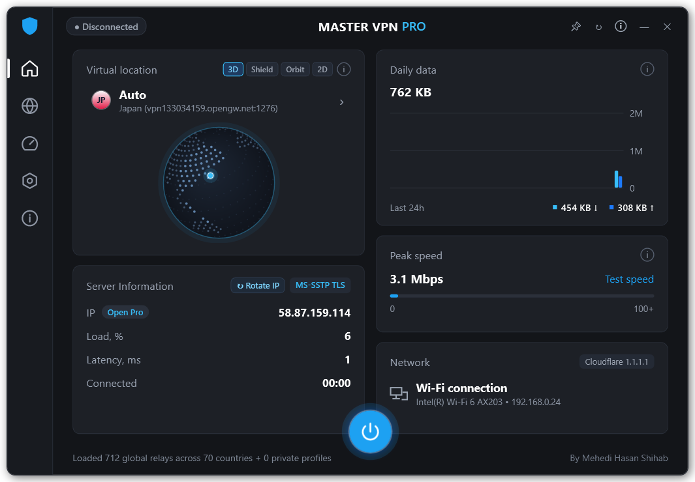
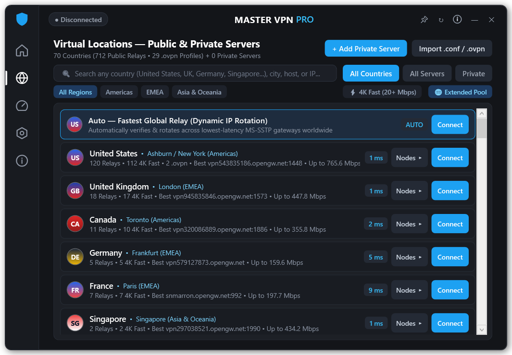
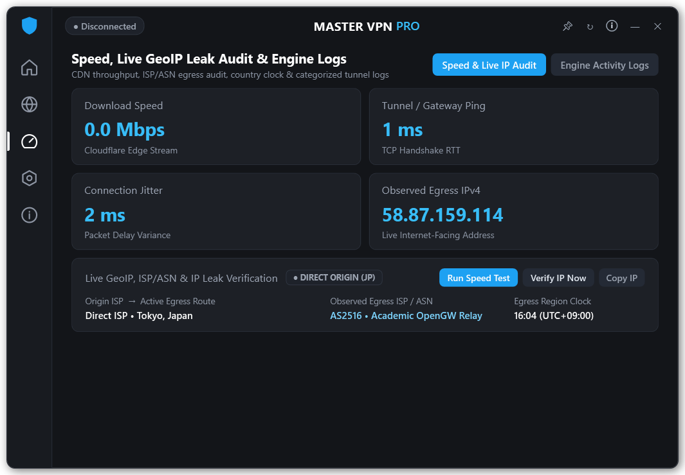
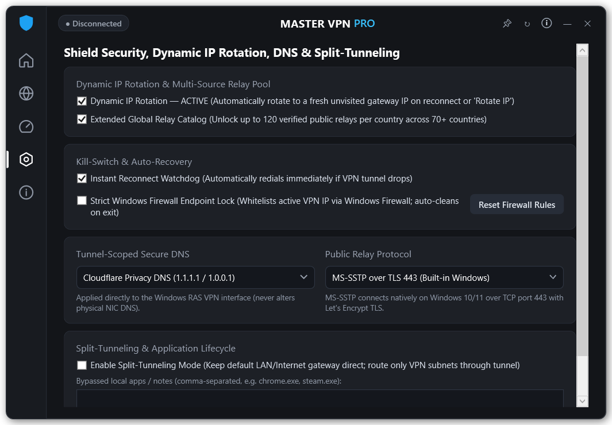
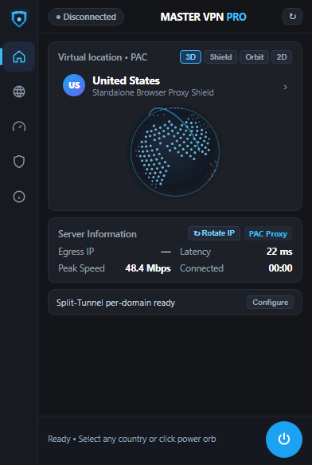
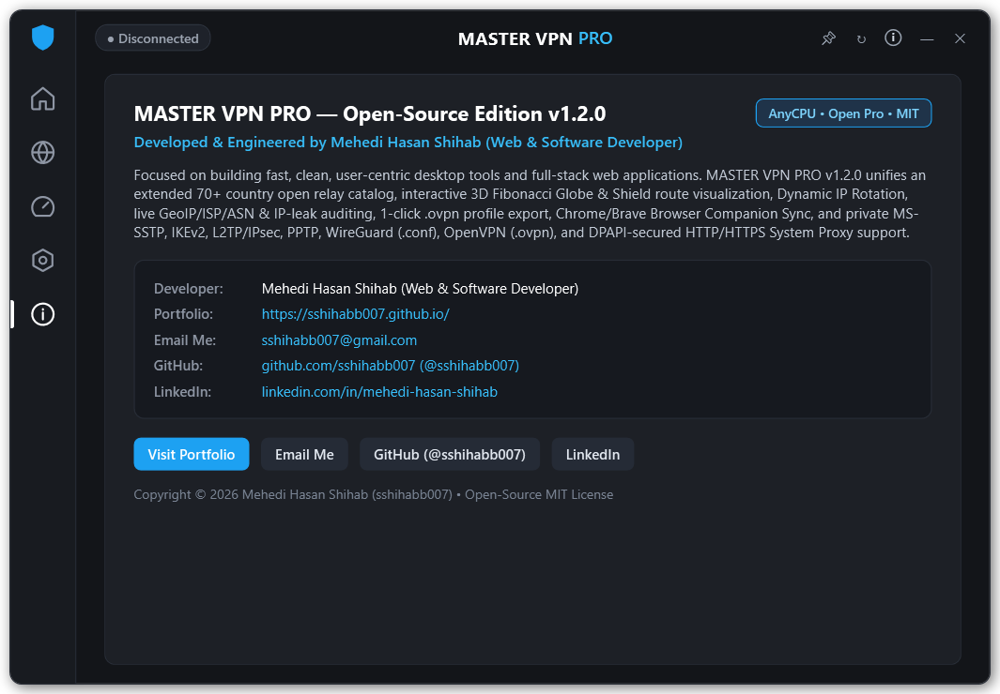
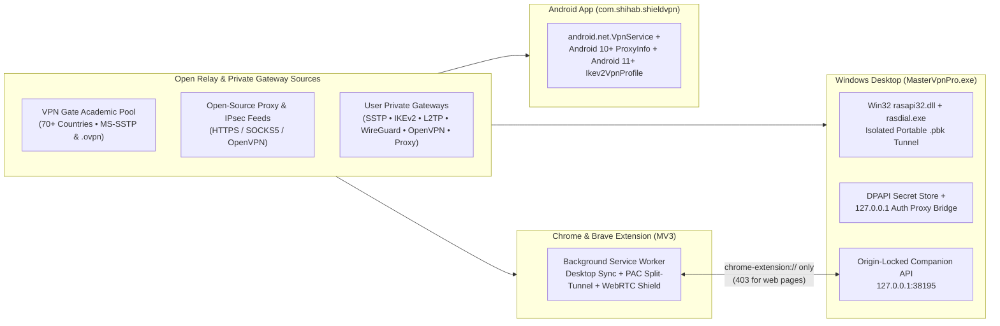

<div align="center">


# MASTER VPN PRO

**Open-Source Multi-Platform VPN & Privacy Shield Ecosystem for Windows Desktop, Chrome & Brave Browsers, and Android Smartphones**

[](https://github.com/sshihabb007/MASTER-VPN-PRO/releases/latest)
[](https://github.com/sshihabb007/MASTER-VPN-PRO/actions)
[](LICENSE)

[](https://github.com/sshihabb007/MASTER-VPN-PRO/releases/latest)
[](https://github.com/sshihabb007/MASTER-VPN-PRO/releases/latest)
[](https://github.com/sshihabb007/MASTER-VPN-PRO/releases/latest)
[](https://sshihabb007.github.io/)

<br />

[**⬇ Download Latest Releases**](https://github.com/sshihabb007/MASTER-VPN-PRO/releases/latest) ·
[**🖥 Windows Guide**](#-1-windows-desktop-edition-setup--portable) ·
[**🌐 Chrome / Brave Guide**](#-2-chrome--brave-browser-extension-manifest-v3) ·
[**📱 Android APK Guide**](#-3-android-smartphone-application-apk) ·
[**🛠 Build from Source**](#-reproducible-builds--self-test-suite)

</div>

---

## ⚡ Official Downloads (`v1.3.0`)

Grab the pre-built, SHA-256 checksummed packages directly from the [**GitHub Releases**](https://github.com/sshihabb007/MASTER-VPN-PRO/releases/latest) page:

| Platform | Edition | Package | Highlights |
| :--- | :--- | :--- | :--- |
| **🖥 Windows 10 / 11** | **Setup Wizard** | [**`MASTER-VPN-PRO-Setup-1.3.0.exe`**](https://github.com/sshihabb007/MASTER-VPN-PRO/releases/latest/download/MASTER-VPN-PRO-Setup-1.3.0.exe) | Graphical Dark Setup Wizard, Desktop & Start Menu shortcuts, optional System Tray auto-start, and clean `Uninstall.exe`. |
| **🖥 Windows 10 / 11** | **Portable `.exe`** | [**`MASTER-VPN-PRO-Portable-1.3.0.exe`**](https://github.com/sshihabb007/MASTER-VPN-PRO/releases/latest/download/MASTER-VPN-PRO-Portable-1.3.0.exe) | Single-file (`~310 KB`), zero-install `AnyCPU` (`x64`/`ARM64`/`x86`) executable with Parallel Direct-IP 1-RTT Gateway Race & isolated `.pbk` phonebook. |
| **🌐 Chrome & Brave** | **Unpacked `.zip`** | [**`MASTER-VPN-PRO-Browser-Extension-1.3.0.zip`**](https://github.com/sshihabb007/MASTER-VPN-PRO/releases/latest/download/MASTER-VPN-PRO-Browser-Extension-1.3.0.zip) | Manifest V3 extension supporting zero-preflight Desktop MS-SSTP Tunnel Sync & Fail-Closed Multi-Proxy PAC + WebRTC leak shield. |
| **🌐 Chrome & Brave** | **Signed `.crx3`** | [**`MASTER-VPN-PRO-Browser-Extension-1.3.0.crx`**](https://github.com/sshihabb007/MASTER-VPN-PRO/releases/latest/download/MASTER-VPN-PRO-Browser-Extension-1.3.0.crx) | Signed Chromium extension archive for offline archiving and enterprise policy deployment. |
| **📱 Android (`8.0–14+`)** | **Signed `.apk`** | [**`MASTER-VPN-PRO-Android-1.3.0.apk`**](https://github.com/sshihabb007/MASTER-VPN-PRO/releases/latest/download/MASTER-VPN-PRO-Android-1.3.0.apk) | `v1 + v2 + v3` signed Android smartphone app (`com.shihab.shieldvpn`) with 16-thread Direct-IP 1-RTT probing, `VpnService` & 3D Fibonacci Globe. |
| **🔐 Integrity** | **SHA-256 Sums** | [**`SHA256SUMS.txt`**](https://github.com/sshihabb007/MASTER-VPN-PRO/releases/latest/download/SHA256SUMS.txt) | Cryptographic SHA-256 digests generated automatically by GitHub Actions CI. |

---

## 🎨 Interface Showcase

### Windows Desktop Dark Bento Suite & Chrome/Brave Companion

| **3D Fibonacci Globe Dashboard** | **70+ Country Public & Private Relays** |
| :---: | :---: |
|  |  |
| **Speed Benchmark & GeoIP Leak Audit** | **Tunnel-Scoped DNS & Kill-Switch Shield** |
|  |  |

<div align="center">
<table>
  <tr>
    <td align="center" width="38%">
      <strong>Chrome &amp; Brave MV3 Popup (<code>392×584</code>)</strong><br /><br />
      
    </td>
    <td align="center" width="62%">
      <strong>Developer &amp; Architecture Info View</strong><br /><br />
      
    </td>
  </tr>
</table>
</div>

---

## 🏗 Multi-Platform Architecture

**MASTER VPN PRO** unifies three native client runtimes around open-source global relay feeds and user-owned private servers—with **zero telemetry, zero ads, zero background services when closed, and zero unauthorized commercial backends**:



---

## ✨ Platform Feature Matrix

| Capability | 🖥 Windows Desktop | 🌐 Chrome & Brave Extension | 📱 Android App (`.apk`) |
| :--- | :---: | :---: | :---: |
| **Dark Bento UI + Interactive 3D Fibonacci Globe (`3D` / `Shield` / `Orbit` / `2D`)** | ✅ | ✅ | ✅ |
| **70+ Country Global Public Relay Aggregator (`Americas`, `EMEA`, `Asia & Oceania`)** | ✅ | ✅ | ✅ |
| **Native Kernel/System Layer-3 VPN Tunnel (`MS-SSTP` / `IKEv2` / `VpnService`)** | ✅ (`MS-SSTP`, `IKEv2`, `L2TP`, `PPTP`) | ✅ *(via Desktop Companion Sync)* | ✅ (`VpnService` + Android 11+ `Ikev2VpnProfile`) |
| **Standalone Proxy Tunneling (`HTTP` / `HTTPS` / `SOCKS5` / `SOCKS4`)** | ✅ *(WinINet + Loopback Auth Bridge)* | ✅ *(Chromium `pac_script`)* | ✅ *(Android 10+ `Builder.setHttpProxy`)* |
| **Private Custom Servers (`WireGuard .conf`, `OpenVPN .ovpn`, `IKEv2`, `Proxy`)** | ✅ | ✅ *(Private Proxies + `.ovpn`)* | ✅ *(Private Proxies + `IKEv2 PSK` + `.ovpn`)* |
| **1-Click `.ovpn` Profile Decoder & Exporter** | ✅ | ✅ | ✅ |
| **Dynamic IP Rotation (`↻ Rotate IP` across unvisited country gateways)** | ✅ | ✅ | ✅ |
| **Split-Tunneling (Bypass Selected Routes / Domains / Apps)** | ✅ *(Gateway Route Split)* | ✅ *(Per-Domain PAC Bypass)* | ✅ *(Per-App `addDisallowedApplication`)* |
| **Tunnel-Scoped Secure DNS (`Cloudflare 1.1.1.1`, `AdGuard AdBlock`, `Quad9`, `Google`)** | ✅ | — *(Browser DoH / WebRTC Shield)* | ✅ |
| **Kill-Switch Watchdog & Clean Crash Recovery** | ✅ *(Auto-Reconnect + Firewall Lock)* | ✅ *(Startup Proxy Reset + WebRTC Lock)* | ✅ *(Always-On Foreground `VpnService`)* |
| **Parallel Direct-IP 1-RTT Lowest-Latency Gateway Race (Zero DNS Inflation)** | ✅ (`28`-way TCP + `18`-way `SSTP` + `ICMP`) | ✅ *(Desktop Sync + Warm Keep-Alive 1-RTT)* | ✅ (`16`-thread Direct-IP Socket Probe) |
| **Live Cloudflare HTTPS Speed Test + GeoIP / ASN / Leak Audit** | ✅ | ✅ | ✅ |

---

## 🔌 Supported Protocols & Gateways

| Protocol | Transport & Port | Security & Credential Handling | Supported Platforms |
| :--- | :--- | :--- | :--- |
| **MS-SSTP** | `TLS 1.2 / 1.3` (`:443` & custom `:port`) | CA-verified TLS + `<1.6s` `SSTP_DUPLEX_POST` pre-flight check via isolated `.pbk` | Windows (+ Browser Sync) |
| **IKEv2 / IPsec** | `UDP 500 / 4500` (`MOBIKE`) | EAP-MSCHAPv2 (Windows RAS) & Pre-Shared Key `Ikev2VpnProfile` (Android 11+) | Windows, Android 11+ |
| **L2TP / IPsec & PPTP** | `UDP 1701` / `TCP 1723` | PSK + DPAPI-encrypted secret storage | Windows |
| **WireGuard (`.conf`)** | `UDP` (custom endpoint port) | Native `.conf` parser + handoff to `wireguard.exe` tunnel service | Windows |
| **OpenVPN (`.ovpn`)** | `TCP / UDP` (`:443` / `:1194`) | Base64 & `.ovpn` parser, 1-click export, and OpenVPN client handoff | Windows, Browser, Android |
| **HTTP / HTTPS / SOCKS5** | `TCP` (`CONNECT` & `SOCKS5`) | Windows DPAPI loopback bridge (`127.0.0.1:0`), Chromium `onAuthRequired`, Android `ProxyInfo` | Windows, Browser, Android |

---

## 🚀 Quick-Start & Installation Guides

### 🖥 1. Windows Desktop Edition (Setup & Portable)

- **Option A — Setup Installer (`MASTER-VPN-PRO-Setup-1.3.0.exe`):**
  1. Download and launch `MASTER-VPN-PRO-Setup-1.3.0.exe`.
  2. Review the planned installation directory (`%LOCALAPPDATA%\Programs\MASTER VPN PRO`) and optional shortcuts, then click **Install**.
  3. Uninstall anytime from **Windows Settings → Installed Apps → MASTER VPN PRO** (or `Uninstall.exe`).
- **Option B — Zero-Install Portable (`MASTER-VPN-PRO-Portable-1.3.0.exe`):**
  1. Place `MASTER-VPN-PRO-Portable-1.3.0.exe` in any folder or USB drive and run it directly—no `.NET SDK`, OpenVPN TAP driver, or WinTUN installation required.
- **Command-Line Automation Flags:**
  ```powershell
  .\MasterVpnPro.exe --status                # Inspect current tunnel & GeoIP status
  .\MasterVpnPro.exe --connect-auto          # Connect automatically to fastest verified relay
  .\MasterVpnPro.exe --disconnect            # Tear down active tunnel & restore direct proxy
  .\MasterVpnPro.exe --minimized             # Start quietly in the Windows System Tray
  .\MasterVpnPro.exe --self-test             # Run 26-check unit, DPAPI, RAS & live network suite
  ```

---

### 🌐 2. Chrome & Brave Browser Extension (`Manifest V3`)

1. Download and extract [**`MASTER-VPN-PRO-Browser-Extension-1.3.0.zip`**](https://github.com/sshihabb007/MASTER-VPN-PRO/releases/latest/download/MASTER-VPN-PRO-Browser-Extension-1.3.0.zip) (or use the [`browser-extension/`](browser-extension/) folder from this repository).
2. Open **`chrome://extensions`** in Google Chrome or **`brave://extensions`** in Brave Browser.
3. Toggle **Developer mode** ON in the top-right corner.
4. Click **Load unpacked** and select the extracted `browser-extension` directory.
5. Pin **MASTER VPN PRO** to your browser toolbar:
   - When `MasterVpnPro.exe` is running on Windows, the extension automatically links to `127.0.0.1:38195` (`● Desktop Ready`) with zero CORS preflight delay so you can switch system-wide MS-SSTP countries in 1 click.
   - When running standalone on Windows, macOS, Linux, or ChromeOS, it verifies live HTTPS `CONNECT` egress before marking `Browser Protected` and routes browser traffic via a **fail-closed multi-proxy PAC chain** (never silently falling back to `DIRECT` on dead proxies) with per-domain bypass rules and WebRTC non-proxied UDP leak blocking.

---

### 📱 3. Android Smartphone Application (`.apk`)

1. Download [**`MASTER-VPN-PRO-Android-1.3.0.apk`**](https://github.com/sshihabb007/MASTER-VPN-PRO/releases/latest/download/MASTER-VPN-PRO-Android-1.3.0.apk) on your Android phone (`Android 8.0 Oreo / API 26` through `Android 14+ / API 34`).
2. Tap the `.apk` to install **MASTER VPN PRO**.
3. Open the app, pick any of the **70+ countries** (or add your own Private Proxy / Android 11+ `IKEv2` PSK server in the **Servers** tab), and tap **CONNECT**.
4. Approve the standard Android `VpnService` connection dialog on first connect.
5. Use the **Shield** tab to switch between **Cloudflare (`1.1.1.1`)**, **AdGuard AdBlock DNS (`94.140.14.14`)**, **Quad9 (`9.9.9.9`)**, or **Google (`8.8.8.8`)**, and exclude specific Android package names via **Per-App Split-Tunneling**.

---

## 🛡 Security, Privacy & Lifecycle Guarantees

- **Zero Plaintext Secrets on Disk or Registry:** Private VPN passwords, L2TP pre-shared keys, and proxy credentials on Windows are encrypted with `ProtectedData.Protect(..., DataProtectionScope.CurrentUser)` (**Windows DPAPI**). Authenticated HTTP/HTTPS system proxies run through an ephemeral local loopback bridge (`127.0.0.1:0`) so credentials are never written in plaintext into `HKCU\...\Internet Settings`.
- **Origin-Locked Loopback Companion (`127.0.0.1:38195`):** Listens strictly on `IPAddress.Loopback`, requires the extension client header on mutating routes, and rejects any web-page `Origin` (`http://` / `https://`) with `403 Forbidden` to prevent cross-site localhost abuse.
- **Additive & Reversible Network State:** Physical network adapter DNS is never overwritten—Secure DNS is scoped strictly to the virtual RAS/TUN interface. Previous WinINet proxy settings and orphaned firewall Kill-Switch rules are snapshotted and automatically restored on disconnect, exit, or post-crash startup recovery.
- **Honest Dual-Stack Leak Auditing:** Resolves your real internet-facing IPv4 (`api.ipify.org` + `ipwho.is`) alongside carrier ASN and regional UTC clock, raising an immediate leak warning if observed egress country differs from your selected gateway.

---

## 🛠 Reproducible Builds & Self-Test Suite

### Repository Layout

```text
MASTER-VPN-PRO/
├── src/                         # Windows C# / WPF Desktop Client & Win32 RAS Engine
│   ├── Core/                    # Domain models, 113-country table, WireGuard/OpenVPN/Proxy parsers
│   ├── Services/                # MS-SSTP/RAS engine, DPAPI config, Loopback Auth & Browser Bridges
│   └── UI/                      # Dark Bento Window, 3D Fibonacci Globe, 24h Charts & System Tray
├── installer/                   # Graphical Dark Windows Setup Wizard & Uninstaller
├── browser-extension/           # Chrome & Brave Manifest V3 Extension (Service Worker + 3D Globe Popup)
├── android-app/                 # Android Smartphone Project (com.shihab.shieldvpn, API 26–34)
├── scripts/                     # Pure-Python multi-size .ico & PNG asset generators
├── docs/screenshots/            # Verified UI screenshots across Desktop & Browser
├── .github/workflows/build.yml  # Automated GitHub Actions Build, Self-Test, APK Sign & Release CI
├── build.ps1                    # Windows Portable + Setup Installer build & 24-check self-test script
└── build-extension.ps1          # Chrome & Brave .zip + signed .crx3 packager
```

### Build Commands

```powershell
# 1. Build Windows Portable + Setup Installer & run the self-test suite
#    (Uses built-in Windows .NET Framework 4.x csc.exe — zero external SDK required)
powershell -ExecutionPolicy Bypass -File .\build.ps1

# 2. Package Chrome & Brave Browser Extension (.zip + .crx)
powershell -ExecutionPolicy Bypass -File .\build-extension.ps1

# 3. Compile, Align & Sign Android Smartphone APK (requires JDK 17+ & Android SDK 34)
powershell -ExecutionPolicy Bypass -File .\android-app\build-apk.ps1
```

---

## 👨‍💻 Developer

Engineered & designed by **Mehedi Hasan Shihab** *(Web & Software Developer)*:

- 🌐 **Portfolio:** [https://sshihabb007.github.io/](https://sshihabb007.github.io/)
- 💻 **GitHub:** [https://github.com/sshihabb007](https://github.com/sshihabb007)
- 💼 **LinkedIn:** [https://www.linkedin.com/in/mehedi-hasan-shihab](https://www.linkedin.com/in/mehedi-hasan-shihab)
- ✉️ **Email:** [sshihabb007@gmail.com](mailto:sshihabb007@gmail.com)

---

## 📄 License

Released under the [**MIT License**](LICENSE). Copyright © 2026 **Mehedi Hasan Shihab (`@sshihabb007`)**.
